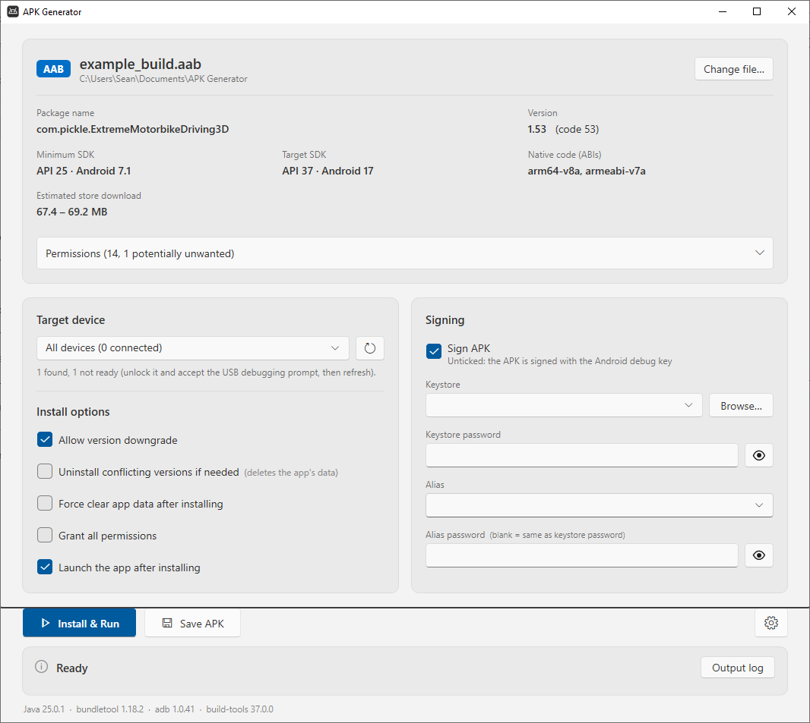

# APK Generator

Drag an `.aab` or `.apk` to get information about the build.
You can then optionally sign it, save it as an APK, or install to connected devices.
Also includes functionality for directly uploading built APKs to FTP.

## What is it

Long ago I wrote a custom batch script to generate APKs from AABs, automate installs and give other build info without needing to use the command line.
This is basically a port of my old batch script to an executable with simpler UI, built by Claude.

## Setup

Works on **Windows** and **macOS** (Apple Silicon and Intel).
Download your appropriate build from the [releases section](https://github.com/Seanm07/APK-Generator/releases), both versions look and work the same (see [Using it](#using-it)).

### Windows

1. Run `APK Generator.exe` (or unzip `APK Generator-win.zip` first if someone sent it to you). Nothing needs installing for the app itself.
2. You need **Java** (if you have Android Studio or Unity installed you already have it).
3. You need **ADB** if you want to install to a connected device (included with Android Studio).

Keystores go in the `Keystores` folder next to the exe. Settings and built APKs are stored next to the exe too.

### macOS

1. Unzip `APK Generator-mac-arm64.zip` (M1 or newer) or `APK Generator-mac-x64.zip` (Intel Macs) and drag **APK Generator** into Applications.
   It's signed and notarized, so it opens without Gatekeeper warnings.
2. You need **Java** and **ADB** (if you have Android Studio you already have both). Otherwise: `brew install --cask temurin android-platform-tools`
3. You can also drop an `.aab`/`.apk` on the Dock icon, or use Open With.

Keystores, settings and built APKs are stored in `~/Library/Application Support/APK Generator` (the app itself is read-only).
Saved passwords are encrypted with a key kept in your login Keychain.

## Using it

1. Open the app and drag your `.aab` or `.apk` into the window.
2. Pick a device and choose **Install & Run**, or **Save APK**.
3. (Optional) Tick **Sign APK**, select the keystore and enter the passwords - details are remembered for future.
4. (Optional) Press the cog to enter the FTP details to enable **Save APK to FTP** for direct FTP uploads.

Add keystores into the `Keystores` folder, browsing for keystores will also store a copy in the folder if they don't exist.

Build and install failures directly appear in the window error log so you don't need to look through logcat.

## Building from source

Needs the .NET 10 SDK. Everything builds on Windows (you don't need a Mac to make the Mac version).

- **Windows app:** `Source\build.ps1`, or `Source\build.ps1 -Package` to also generate the shared zip.
- **Mac app:** `Source\mac\build-mac.ps1` to build an unsigned build, to sign and notarize if you have a rcodesign setup add a `-Sign` flag.

The Windows app uses WPF, the Mac app uses [Avalonia](https://avaloniaui.net). The logic (and all the view-models) is shared in `ApkGenerator.Core`.
